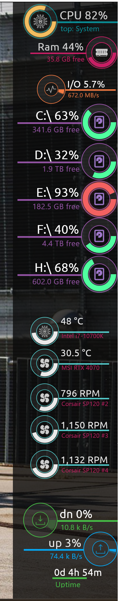
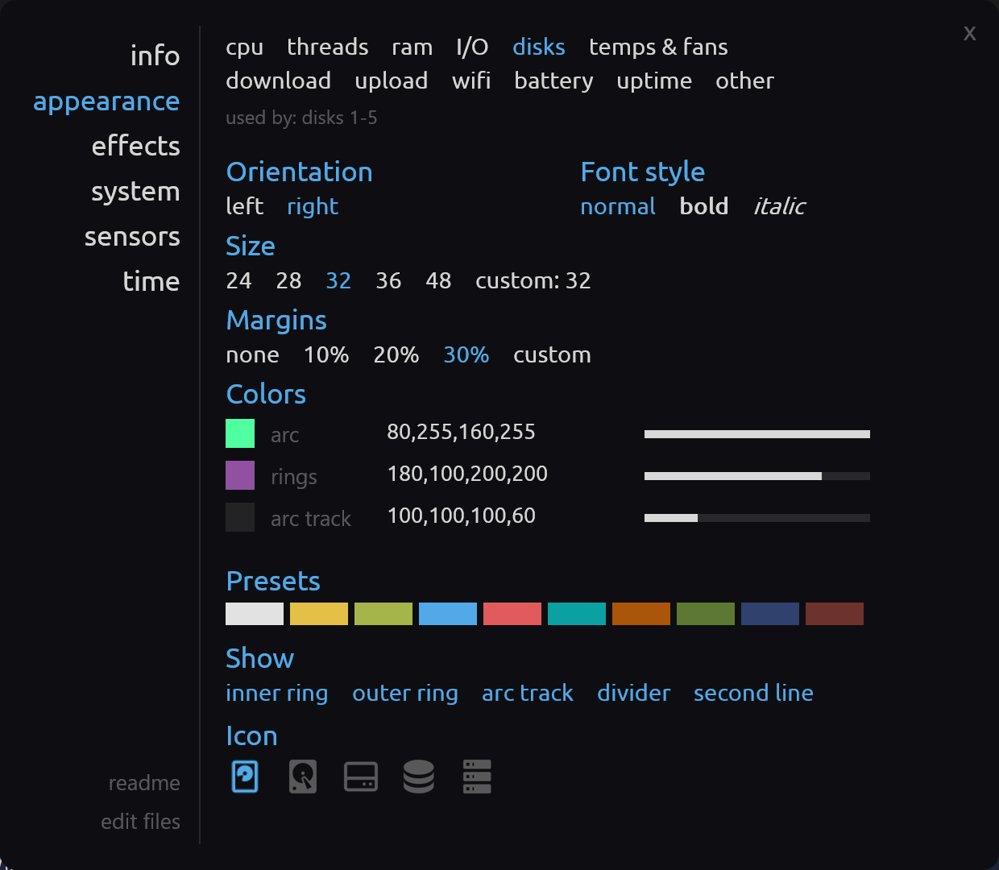
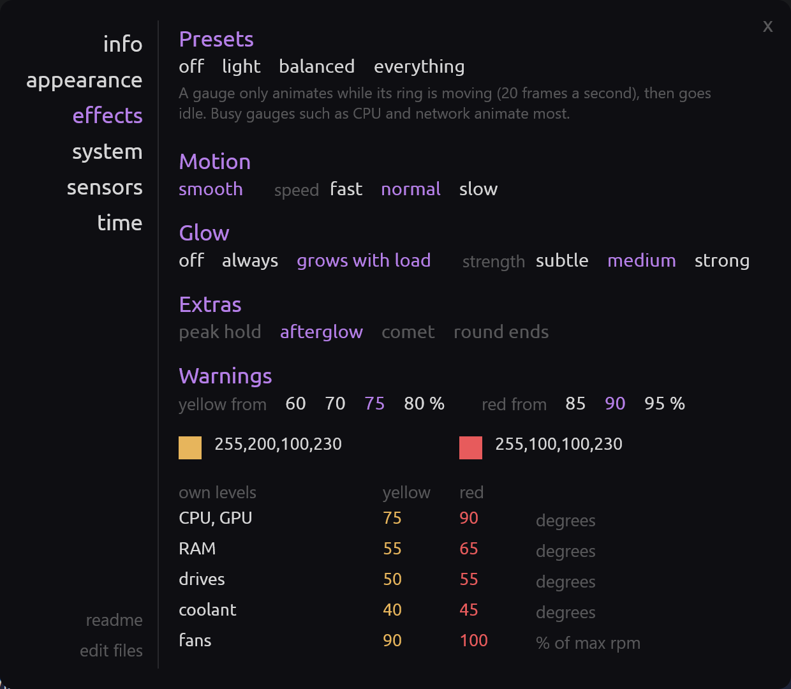
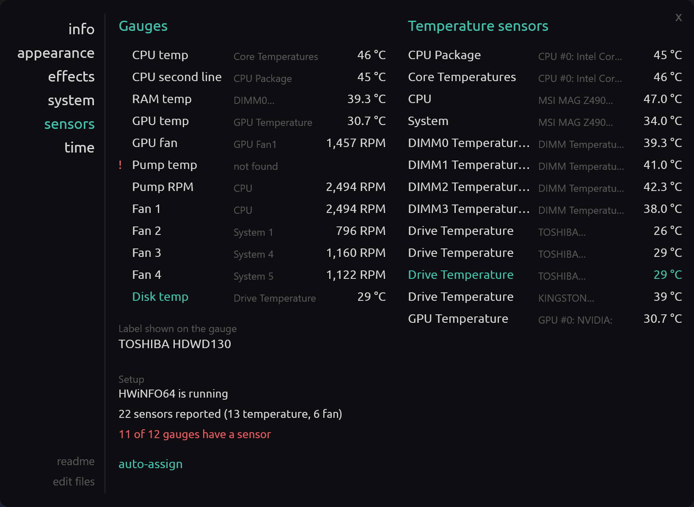
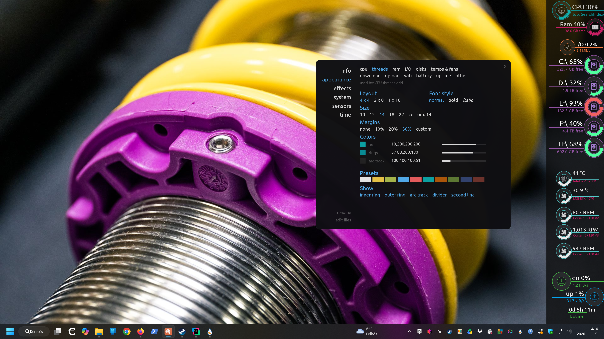
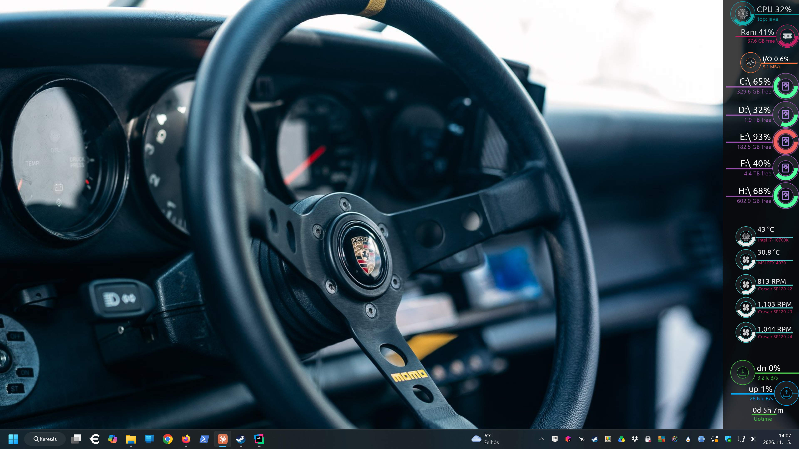
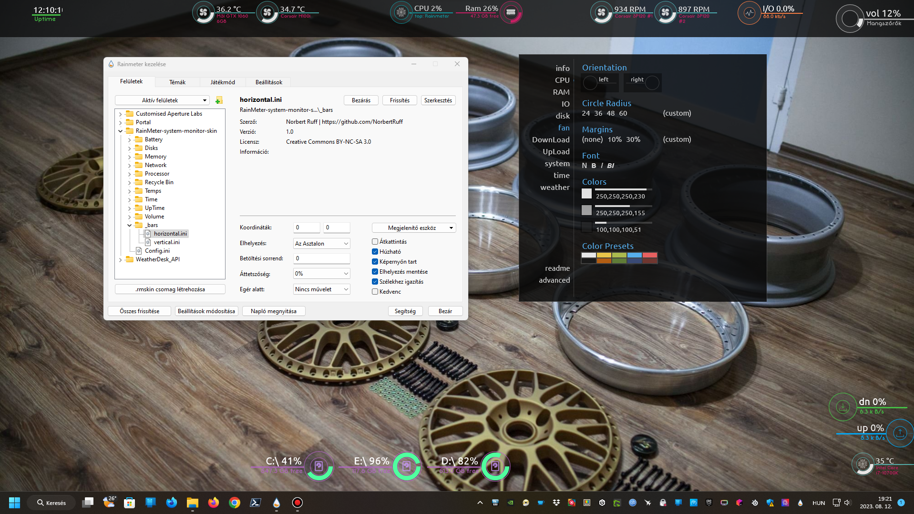
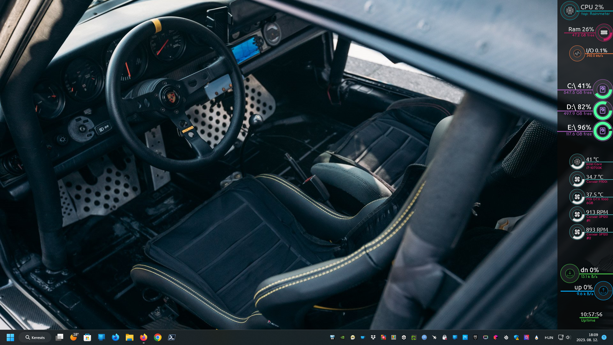

<h1 align="center">NeoGauge</h1>

  Animated ring gauges for your Windows desktop, built on <a href="https://www.rainmeter.net/">Rainmeter</a>. 
  CPU, RAM, disks, network, temperatures, fans and more, with a settings window so you never have to edit a file.

  
  
  

<b><a href="https://github.com/NorbertRuff/NeoGauge/releases/latest">⬇️ Download NeoGauge 2.0</a></b>

NeoGauge is based on Flying Hyrax's [Circoustwo](https://www.deviantart.com/flyinghyrax) design. Version 2.0 (November 2026) is a rework of the 2023 release: animated rings, warning colours, a much larger config tool, easy HWiNFO setup, and about a third of the CPU use of 1.0. See the [2.0 release notes](https://github.com/NorbertRuff/NeoGauge/releases/tag/v2.0) for the full list.

## Contents

- [Screenshots](#screenshots)
- [Gauges](#gauges)
- [Installation](#installation)
- [Temperature and fan sensors (HWiNFO)](#temperature-and-fan-sensors-hwinfo)
- [Configuration](#configuration)
- [Performance](#performance)
- [Known issues](#known-issues)
- [Credits](#credits)
- [About me](#about-me)

## Screenshots

<table>
  <tr>
    <td valign="top" width="25%"></td>
    <td valign="top">
       
      
    </td>
  </tr>
</table>

Left: the gauges, with the yellow and red warning colours on a busy CPU and a nearly full drive. Right: the config tool's **appearance** and **effects** pages. The **sensors** page:

## Gauges

Load any of these from Rainmeter's Manage window, under `NeoGauge`:

| Folder | Gauges |
|---|---|
| `Processor` | CPU load with the top process, cores 1-4, and a threads grid (one small ring per thread, up to 16) |
| `Memory` | RAM, swap |
| `Disks` | drive activity (I/O), disks 1-5 (used space) |
| `Network` | download, upload, wifi signal |
| `Temps` | CPU, GPU, RAM and drive temperature, pump, fans 1-4 (need HWiNFO) |
| `Time`, `UpTime` | clock, uptime |
| `Battery`, `Volume`, `Recycle Bin` | battery, volume, recycle bin size |
| `_bars` | a horizontal or vertical background bar to sit the gauges on |
| root | `Config.ini`, the settings window |

## Installation

Needs Windows 10 or 11 and [Rainmeter](https://www.rainmeter.net/) 4.5 or newer. [HWiNFO64](https://www.hwinfo.com/download/) is optional, only for the temperature, fan and pump gauges. The Ubuntu Nerd Font ships with the skin and loads automatically.

1. Install Rainmeter.
2. Download `NeoGauge_2.0.rmskin` from the [latest release](https://github.com/NorbertRuff/NeoGauge/releases/latest) and double-click it. The config tool opens when the install finishes.
   Or clone this repository into your Rainmeter skins folder (usually `Documents\Rainmeter\Skins\NeoGauge`) and refresh Rainmeter.
3. Load the gauges you want from Rainmeter's Manage window.
4. Set everything up in the config tool (`NeoGauge\Config.ini`).

**Updating from 1.0:** install the new `.rmskin` over the old one. Your `Settings.txt` and appearance values are kept, new settings get their defaults, and the old folder is moved to `Skins\@Backup`. HWiNFO sensor numbers from 1.0 usually point at the wrong sensors, so open the config tool's **sensors** page and press **auto-assign**.

### Display scaling (125 % / 150 % / 200 %)

Rainmeter doesn't handle Windows display scaling itself, so on a scaled display Windows stretches the skins and they look blurry. For sharp gauges:

1. Right-click `C:\Program Files\Rainmeter\Rainmeter.exe` > **Properties** > **Compatibility** > **Change high DPI settings**.
2. Tick **Override high DPI scaling behavior**, set it to **Application**, and restart Rainmeter.
3. On the config tool's **system** page, set **Display scale** to your Windows scale (e.g. 200 %).

Every gauge, font and the config window scale from that one setting. If your gauges jump to new spots after step 2, drag them back once.

## Temperature and fan sensors (HWiNFO)

The temperature, fan and pump gauges read HWiNFO's sensors through the Windows registry:

1. In HWiNFO's sensors window, open **Settings** > **HWiNFO Gadget**, tick **Enable reporting to Gadget**, then select each sensor you want and tick **Report value in Gadget**.
2. Keep HWiNFO running.
3. On the config tool's **sensors** page, click **auto-assign**. It matches the gauges to sensors by name (CPU Package, GPU Temperature, DIMM, Drive Temperature, fan headers). To fix a miss, click a gauge on the left, then the sensor it should read on the right.

The **Setup** lines on that page say whether HWiNFO is running, how many sensors it reports and how many gauges have one; hover a red line for what to do. A gauge without a sensor shows N/A and "no sensor": click it to open the sensors page on that gauge.

HWiNFO numbers its sensors in the order you enabled them, so adding or removing one there can shift them. The sensors page marks a gauge whose sensor is gone with `!`, and one whose sensor moved with `~` (click the `~` to follow it).

Tip: back up your HWiNFO sensor ticks with `reg export HKCU\SOFTWARE\HWiNFO64\Sensors hwinfo-sensors.reg`, and double-click the file after reinstalling HWiNFO (same hardware only).

## Configuration

Load `Config.ini` (the `NeoGauge` root skin) for the settings window. Every click applies right away, and the current choice is highlighted.

- **appearance**: pick a gauge group at the top (cpu, threads, ram, I/O, disks, temps & fans, download, upload, wifi, battery, uptime, other), then set its orientation (for **threads**, the layout: 4 x 4, 2 x 8 or 1 x 16), size, margins, font style, colours (click a colour to type a new one, click the bar to set its opacity), colour presets, which parts of the ring to show, and for disks, download and upload the icon.
- **effects**: how the rings move, for every gauge at once:
    - presets: **off** (jump once a second, the lightest), **light**, **balanced**, **everything**
    - **smooth** motion and its speed
    - **glow**: off, always, or growing with load (55-90 %), at three strengths
    - **peak hold**: a tick marks the recent high, then slides back
    - **afterglow**: drops fade out instead of vanishing
    - **comet**: the arc brightens toward a glowing tip (the heaviest effect)
    - **round ends** on the arc
- **system**: display scale, fonts, the drive letters for the five disk gauges, your connection speed (the network gauges show traffic as a share of it), the fan RPM that counts as 100 %, and the recycle bin size (plus an opt-in to empty it automatically when full).
- **sensors**: which HWiNFO sensor each temperature, fan and pump gauge reads, picked by name with its live value, and the label shown under the gauge (click it to type a new one).
- **time**: what the clock's ring tracks (minute to year), and the time and date formats.

**Warning colours:** a ring turns yellow from 75 % and red from 90 % (not battery, wifi, volume or the clock). Both levels and both colours are under **Warnings** on the effects page. Temperatures and fans have their own levels there (click a number to change it): CPU/GPU 75 / 90 °C, RAM 55 / 65 °C, drives 50 / 55 °C, coolant 40 / 45 °C, and fans 90 / 100 % of the max RPM.

**Other handy clicks:**
- Hover a gauge's main text for its peak values since load; right-click it to reset them.
- Click the CPU text to open Task Manager, or a disk's text to open the drive.

Everything is stored in plain text files that you can also edit by hand ("edit files" in the config window opens them):
- `@Resources\Settings.txt`: system, time and effects settings, HWiNFO sensors
- `@Resources\Apparence\*.txt`: one appearance file per gauge group

## Performance

Rainmeter's own CPU and RAM use with the same 17 gauges loaded:

| | 1.0 | 2.0, effects **balanced** | 2.0, effects **off** |
|---|---|---|---|
| CPU, average | ~52 % of one core (3.2 % of total) | ~17 % of one core (1.1 % of total) | ~5 % of one core (0.3 % of total) |
| CPU, busiest seconds (95th percentile) | 57-59 % of one core | 48-65 % of one core | ~16 % of one core |
| RAM in use (working set) | 55 MB | 66-67 MB | ~71 MB |
| RAM owned by Rainmeter (private) | 26-27 MB | ~32 MB | - |

- **CPU is much lower on average** mainly because the CPU gauge's top-process check (the AdvancedCPU plugin, the most expensive measure in the suite) runs every 30 s instead of every 3 s. Other updates are trimmed to what's visible too: HWiNFO sensors are read every 2 s (as often as HWiNFO refreshes them), the background bar draws once, and uptime updates every 10 s.
- **The ring animations are most of what's left** (~12 % of one core on average with balanced). A gauge redraws 20 times a second only while its ring moves, then goes idle, so busy gauges (CPU, network, disk activity) cause the peaks. The **light** or **off** preset removes most of that cost.
- **RAM is ~10 MB higher** than 1.0: 2.0 draws the gauges at full display resolution (4x the pixels at 200 % scaling) and adds the effect meters and a small Lua script per gauge.
- **The CPU threads grid** (16 small rings, no animation) adds ~2 MB of RAM and no measurable CPU.

How it was measured (October 2026): Rainmeter 4.5.28 64-bit, Windows 11 Pro 25H2, Intel i7-10700K (16 threads), 200 % display scaling with Rainmeter's high-DPI override on. Rainmeter was restarted, left to settle for 20 s, then sampled once a second for 60 s, 1-2 runs per column. The PC was in normal use (browser, IDE), so expect some spread between runs. Loaded gauges: CPU, RAM, disk activity, disks 1-5, download, upload, CPU and GPU temperature, fans 2-4, uptime, background bar.

## Known issues

- **UsageMonitor crashes Rainmeter 4.5.28** on some PCs, so NeoGauge doesn't use it yet. As a result, the core gauges show the base clock instead of the live one, and the CPU gauge updates its top-process name every 30 s.
- **Temperatures assume °C.** If HWiNFO is set to °F, the temperature rings and warning levels are off.

Found something else? [Open an issue](https://github.com/NorbertRuff/NeoGauge/issues).

## Credits

- Design based on [Flying Hyrax](https://www.deviantart.com/flyinghyrax)'s Circoustwo
- [Rainmeter](https://www.rainmeter.net/) and [HWiNFO](https://www.hwinfo.com/)
- [Ubuntu Nerd Font](https://www.nerdfonts.com/) (Ubuntu Font Licence)
- Extra disk and network icons: [Material Design Icons](https://pictogrammers.com) (Apache 2.0) and [Font Awesome](https://fontawesome.com) (CC BY 4.0), see `@Resources\Icons\credits.txt`

NeoGauge is licensed under [Creative Commons BY-NC-SA 3.0](https://creativecommons.org/licenses/by-nc-sa/3.0/).

Contributions, issues and feature requests are welcome. Give it a ⭐️ if you like it!

## About me

Hi 👋, I'm Norbert, a developer from Apex Lab Hungary. More of my projects are on [GitHub](https://github.com/NorbertRuff).

